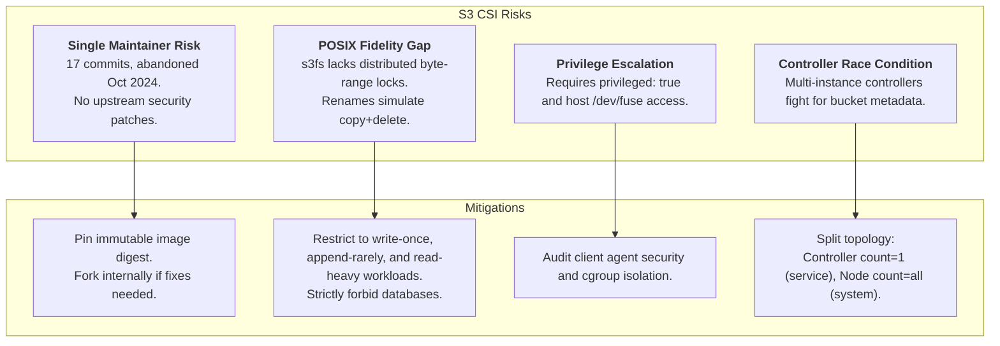

# Sub-Task 2: CSI Plugin State Audit & Go/No-Go Assessment (DEV-934)

## 1. Executive Summary

Nomad has no native network storage layer of its own. Stateful workloads depend on host volumes, network shares (NFS), or CSI plugins. To answer the architectural question posed in Jira **DEV-932**—*Can Silo (S3-compatible object store) serve as an external persistent volume substrate for Nomad workloads?*—this sub-task audits the only actively targeted Nomad S3 CSI plugin: [`mwantia/nomad-csi-s3-plugin`](https://github.com/mwantia/nomad-csi-s3-plugin).

### Verdict: **PROCEED WITH RESERVATIONS (GO-WITH-CONDITIONS)**

The plugin demonstrates correct Nomad CSI interface contracts and packages necessary FUSE utilities (`s3fs v1.89`, `bindfs`). However, due to its single-maintainer status, lack of upstream development velocity since October 2024, and fundamental limitations inherent to POSIX-over-S3 abstraction layers, it cannot be recommended unconditionally for general-purpose stateful workloads. We proceed to deploy, validate, and torture-test the plugin in Sub-Tasks 3 through 6 under strict operational guardrails.

---

## 2. Upstream Repository Audit

* **Repository URL:** [https://github.com/mwantia/nomad-csi-s3-plugin](https://github.com/mwantia/nomad-csi-s3-plugin)
* **License:** MIT License (with Apache 2.0 reference in documentation)
* **Lineage:** Forked and adapted from the unmaintained Kubernetes driver [`ctrox/csi-s3`](https://github.com/ctrox/csi-s3).

### Repository Metrics (Captured Live via GitHub API)

| Metric | Upstream Status | Assessment / Risk |
|---|---|---|
| **First Commit** | 2024-10-27T15:04:47Z | Project is very young (created late October 2024). |
| **Last Push Date** | 2024-10-31T12:38:45Z | Repository has seen zero commits since October 31, 2024. |
| **Total Commit Count** | 17 commits | Entire development span was 5 calendar days. |
| **Active Maintainers** | 1 (`mwantia`) | Extreme bus factor (single author, no organization). |
| **Stargazers / Watchers**| 0 / 0 | Minimal community visibility and adoption. |
| **Open Issues / PRs** | 0 / 0 | No active issue tracker engagement or bug reports. |
| **Upstream Warning** | Present in `README.md` | Author explicitly warns: *"WARNING: This plugin is experimental and should be used in production environments at your own risk."* |

*(See full raw GitHub API payload in [`docs/02-plugin-state-and-go-no-go/evidence/github-repo-audit.txt`](file:///var/home/syedadil/personal/silo-nomad-storage-network/docs/02-plugin-state-and-go-no-go/evidence/github-repo-audit.txt) and commit log in [`docs/02-plugin-state-and-go-no-go/evidence/github-commits.txt`](file:///var/home/syedadil/personal/silo-nomad-storage-network/docs/02-plugin-state-and-go-no-go/evidence/github-commits.txt)).*

---

## 3. Container Image Inspection & Version Discrepancy

We inspected the available container release tags on Docker Hub:

```
docker.io/mwantia/nomad-csi-s3-plugin:latest
docker.io/mwantia/nomad-csi-s3-plugin:v1.0.4
docker.io/mwantia/nomad-csi-s3-plugin:v1.0.2
docker.io/mwantia/nomad-csi-s3-plugin:v1.0.1
docker.io/mwantia/nomad-csi-s3-plugin:v1.0.0
```

### Critical Finding: The `--config` Flag Gap in `v1.0.1`

A live CLI inspection of container image binaries revealed a critical discrepancy between `v1.0.1` and `v1.0.4` / `latest`:

1. **Tag `v1.0.1`**:
   * Digest: `sha256:b72f1a95a85859463513cd79c95c49f43740ab74ad07480653c1a75900369d06`
   * Does **not** support the `--config` flag:
     ```
     $ sudo podman run --rm docker.io/mwantia/nomad-csi-s3-plugin:v1.0.1 --nodeid test --config=/dev/null
     flag provided but not defined: -config
     ```
   * Passing `--config=/secrets/config.yml` (as shown in the upstream README and examples) causes `v1.0.1` to crash immediately on container launch. In `v1.0.1`, credentials can only be supplied directly via volume `secrets {}` blocks.

2. **Tag `v1.0.4` / `latest`**:
   * Digest: `sha256:7f3981c168b3ab610a2898167bf6f73be07bc8876ec8e63182a4203a163c004c`
   * Added in commit `c55e9b25` (2024-10-31), introducing the `-config` flag and `spf13/viper` YAML alias support.
   * Both `v1.0.4` and `latest` resolve to the exact same image configuration hash (`2bc9725d30`).

### Underlying FUSE Stack
* Inside the container, the POSIX-over-S3 mounter binary is `/usr/bin/s3fs`.
* Version: `Amazon Simple Storage Service File System V1.89 (commit:unknown) with GnuTLS(gcrypt)`.
* Helper utility: `bindfs` is bundled to stage allocation-specific directories.

*(See raw logs in [`docs/02-plugin-state-and-go-no-go/evidence/plugin-v1.0.1-help.txt`](file:///var/home/syedadil/personal/silo-nomad-storage-network/docs/02-plugin-state-and-go-no-go/evidence/plugin-v1.0.1-help.txt), [`docs/02-plugin-state-and-go-no-go/evidence/plugin-v1.0.4-help.txt`](file:///var/home/syedadil/personal/silo-nomad-storage-network/docs/02-plugin-state-and-go-no-go/evidence/plugin-v1.0.4-help.txt), and [`docs/02-plugin-state-and-go-no-go/evidence/s3fs-version.txt`](file:///var/home/syedadil/personal/silo-nomad-storage-network/docs/02-plugin-state-and-go-no-go/evidence/s3fs-version.txt)).*

---

## 4. Alternative Solutions Survey

| Solution | Mechanism | Nomad Native? | Status / Evaluation |
|---|---|---|---|
| **`mwantia/nomad-csi-s3-plugin`** | Nomad CSI (`s3fs` + `bindfs`) | Yes | Sole active Nomad-targeted S3 CSI driver. Selected for evaluation. |
| **`ctrox/csi-s3`** | Kubernetes CSI (`s3fs`, `geese`, `rclone`) | No (K8s) | Upstream ancestor. Abandoned with unmerged PRs; does not support Nomad mount staging paths. |
| **Static Host FUSE (`s3fs` fallback)** | Host mount via `/usr/bin/s3fs` -> Nomad Host Volume | Partial | Evaluated in Sub-Task 7. Reliable fallback, but bypasses Nomad CSI scheduling and dynamic provisioning. |
| **Native Nomad NFS Volume** | Kernel NFS client -> Nomad Host Volume | Native | Industry standard for shared POSIX storage in Nomad. Evaluated as benchmark baseline in Sub-Task 6. |
| **Vendor CSI Drivers (EBS, Ceph, etc.)** | Block / Distributed FS CSI | Native | Production-ready, but tied to specific cloud vendors or require heavy Ceph clusters rather than lightweight S3 object storage. |

---

## 5. Architectural Risk Assessment



---

## 6. Formal Go/No-Go Decision Matrix

| Dimension | Weight | Score (1-5) | Rationale |
|---|:---:|:---:|---|
| **Nomad CSI Spec Adherence** | High | 4/5 | Properly implements Controller and Node CSI gRPC services for Nomad v1.3+. |
| **Operational Simplicity** | Medium | 4/5 | Deploys cleanly as standard Nomad job specifications; uses standard S3 credentials. |
| **Community & Maintenance** | High | 1/5 | Inactive upstream since October 2024; single author; 0 stars. |
| **POSIX Semantics & Safety** | Critical | 2/5 | Subject to `s3fs` object store emulation risks (no atomicity guarantees, eventual consistency latency). |
| **Workload Suitability** | High | 3/5 | Suitable for read-heavy or asset storage; catastrophic for write-heavy databases (SQLite, PostgreSQL). |

### Conditions of the "Go" Decision
1. **Pinned Image Digest:** All deployments must pin the immutable digest:
   * For configuration alias mode: `docker.io/mwantia/nomad-csi-s3-plugin:v1.0.4@sha256:7f3981c168b3ab610a2898167bf6f73be07bc8876ec8e63182a4203a163c004c`
   * For direct secrets mode: `docker.io/mwantia/nomad-csi-s3-plugin:v1.0.1@sha256:b72f1a95a85859463513cd79c95c49f43740ab74ad07480653c1a75900369d06`
2. **Split Deployment Topology:** The controller must be deployed as a singleton (`type = "service"`, `count = 1`), while node mounters run on every host (`type = "system"`).
3. **Strict Workload Boundary:** S3 CSI volumes must **never** be used for ACID databases, WAL files, or concurrent multi-writer shared appends.
4. **FUSE Fallback Retained:** The static host FUSE fallback (Sub-Task 7) must be maintained as a validated disaster-recovery alternative.

---

## 7. Verification & Reproduction Steps

To independently verify the upstream repository audit and inspect the image flags:

```bash
# 1. Query upstream GitHub metadata
curl -s https://api.github.com/repos/mwantia/nomad-csi-s3-plugin | jq '{name, full_name, created_at, pushed_at, open_issues_count}'

# 2. Inspect commit history
curl -s https://api.github.com/repos/mwantia/nomad-csi-s3-plugin/commits | jq -r '.[] | "\(.commit.author.date) | \(.sha[:8]) | \(.commit.message | split("\n")[0])"'

# 3. Pull and inspect v1.0.1
sudo podman pull docker.io/mwantia/nomad-csi-s3-plugin:v1.0.1
sudo podman inspect docker.io/mwantia/nomad-csi-s3-plugin:v1.0.1 --format '{{.Digest}}'
sudo podman run --rm docker.io/mwantia/nomad-csi-s3-plugin:v1.0.1 --help

# 4. Pull and inspect v1.0.4 (demonstrating -config support)
sudo podman pull docker.io/mwantia/nomad-csi-s3-plugin:v1.0.4
sudo podman inspect docker.io/mwantia/nomad-csi-s3-plugin:v1.0.4 --format '{{.Digest}}'
sudo podman run --rm docker.io/mwantia/nomad-csi-s3-plugin:v1.0.4 --help
```
