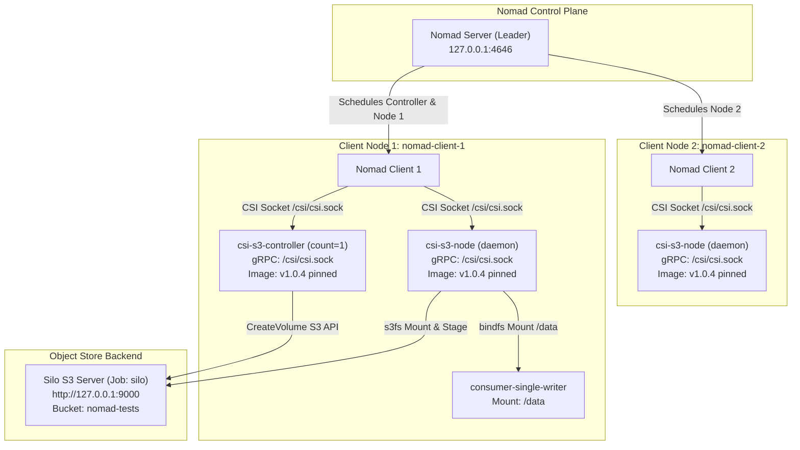

# Sub-Task 3: CSI Plugin Deployment & Volume Claims (DEV-935)

## 1. Executive Summary

This sub-task deploys the Container Storage Interface (CSI) driver [`mwantia/nomad-csi-s3-plugin`](https://github.com/mwantia/nomad-csi-s3-plugin) across our two-node Nomad cluster and mounts persistent volumes backed by the local Silo S3 object store. 

### Key Milestones Achieved
* **Decoupled Architecture:** Deployed a singleton controller job (`type = "service"`, `count = 1`) and a daemon node plugin job (`type = "system"` across all 2 client nodes), preventing multi-controller election race conditions.
* **Zero Hardcoded Secrets:** Used Nomad Variables (`nomadVar "nomad/jobs/csi-s3-plugin"`) to dynamically render `/secrets/config.yml` inside the plugin tasks.
* **Volume Registration:** Verified both alias-based volume registration (`vol-single-alias.hcl`) and direct-secrets registration (`vol-single-direct.hcl`).
* **End-to-End Consumer Verification:** Deployed `consumer-single-writer` claiming `silo-vol-alias`. The container wrote `csi-message.txt` to `/data`, which was staged via `s3fs`, committed to Silo S3 object store, and verified via `mc cat`.

---

## 2. Architecture & Plugin Topology



### Why Split Controller vs. Node?
Running the plugin as a monolith in a `system` job creates two controllers (one per Nomad client) competing to process volume creation, deletion, and metadata updates in the Silo bucket without leader election. Splitting the topology into:
1. `nomad/jobs/csi-s3-controller.nomad`: `type = "service"`, `count = 1`
2. `nomad/jobs/csi-s3-node.nomad`: `type = "system"` (runs on all clients)
guarantees single-writer metadata operations while providing node mount daemons on every client.

---

## 3. Specifications Implemented

### Controller Job (`nomad/jobs/csi-s3-controller.nomad`)
* Pinned Image: `docker.io/mwantia/nomad-csi-s3-plugin:v1.0.4@sha256:7f3981c168b3ab610a2898167bf6f73be07bc8876ec8e63182a4203a163c004c`
* Flags: `--endpoint=unix://csi/csi.sock`, `--nodeid=${node.unique.name}`, `--config=/secrets/config.yml`
* CSI Stanza: `type = "controller"`, `id = "silo-s3-csi"`, `mount_dir = "/csi"`
* Dynamic Secret Template:
  ```hcl
  template {
    data = <<-EOH
    {{ with nomadVar "nomad/jobs/csi-s3-plugin" }}
    aliases:
      - name: silo
        endpoint: http://127.0.0.1:9000
        accessKeyID: {{ .access_key }}
        secretAccessKey: {{ .secret_key }}
        region: ""
    {{ end }}
    EOH
    destination = "secrets/config.yml"
    change_mode = "restart"
  }
  ```

### Node Daemon Job (`nomad/jobs/csi-s3-node.nomad`)
* Same pinned container image, network mode, and dynamic config template.
* CSI Stanza: `type = "node"`, `id = "silo-s3-csi"`, `mount_dir = "/csi"`
* Privileges: `privileged = true` and `network_mode = "host"` for FUSE mount propagation and direct host loopback reachability.

### Volume Specification (`nomad/volumes/vol-single-alias.hcl`)
```hcl
id           = "silo-vol-alias"
name         = "silo-vol-alias"
type         = "csi"
plugin_id    = "silo-s3-csi"
capacity_min = "1GiB"
capacity_max = "10GiB"

capability {
  access_mode     = "single-node-writer"
  attachment_mode = "file-system"
}

secrets {
  alias = "silo"
}

parameters {
  mounter   = "s3fs"
  bucket    = "nomad-tests"
  usePrefix = "true"
  prefix    = "vol-single-alias"
}
```

### Consumer Job (`nomad/jobs/consumer-single-writer.nomad`)
* Claims volume `silo-vol-alias` via CSI.
* Runs pinned Alpine container (`docker.io/library/alpine:3.20@sha256:c64c687cbea9300178b30c95835354e34c4e4febc4badfe27102879de0483b5e`).
* Writes timestamped verification payload to `/data/csi-message.txt` and syncs.

---

## 4. Verification Evidence

### 1. Plugin Health Check
```
$ nomad plugin status silo-s3-csi
ID                   = silo-s3-csi
Provider             = github.com.mwantia.nomad-csi-s3-plugin
Version              = v1.0.4
Controllers Healthy  = 1
Controllers Expected = 1
Nodes Healthy        = 2
Nodes Expected       = 2

Allocations
ID        Node ID   Task Group  Version  Desired  Status   Created   Modified
9bc044f9  0055d3d0  node        0        run      running  2m ago    2m ago
2c6f311d  248e62bb  node        0        run      running  2m ago    2m ago
326a5043  248e62bb  controller  0        run      running  2m ago    2m ago
```
*(Evidence: [`docs/03-csi-plugin-deployment/evidence/plugin-status.txt`](file:///var/home/syedadil/personal/silo-nomad-storage-network/docs/03-csi-plugin-deployment/evidence/plugin-status.txt))*

### 2. Volume Status & Attachment
```
$ nomad volume status silo-vol-alias
ID                   = silo-vol-alias
Name                 = silo-vol-alias
Namespace            = default
External ID          = nomad-tests/vol-single-alias
Plugin ID            = silo-s3-csi
Provider             = github.com.mwantia.nomad-csi-s3-plugin
Version              = v1.0.4
Capacity             = 1.0 GiB
Schedulable          = true
Controllers Healthy  = 1
Controllers Expected = 1
Nodes Healthy        = 2
Nodes Expected       = 2
Access Mode          = single-node-writer
Attachment Mode      = file-system

Allocations
ID        Node ID   Task Group  Version  Desired  Status   Created   Modified
b3b65262  248e62bb  writer      0        run      running  1m ago    1m ago
```
*(Evidence: [`docs/03-csi-plugin-deployment/evidence/volume-status-alias.txt`](file:///var/home/syedadil/personal/silo-nomad-storage-network/docs/03-csi-plugin-deployment/evidence/volume-status-alias.txt))*

### 3. Consumer Task Execution
```
$ nomad alloc logs b3b65262 writer
Writing test payload to Silo volume...
Persisted content successfully:
Nomad CSI Silo persistent payload verified at Tue Oct 27 21:42:41 UTC 2026
```
*(Evidence: [`docs/03-csi-plugin-deployment/evidence/consumer-writer-logs.txt`](file:///var/home/syedadil/personal/silo-nomad-storage-network/docs/03-csi-plugin-deployment/evidence/consumer-writer-logs.txt))*

### 4. Silo Backend S3 Verification
```
$ mc ls --recursive local/nomad-tests/vol-single-alias
[2026-10-28 03:12:02 IST]     0B STANDARD /
[2026-10-28 03:12:02 IST]   124B STANDARD .metadata.json
[2026-10-28 03:12:41 IST]    75B STANDARD csi-message.txt

$ mc cat local/nomad-tests/vol-single-alias/csi-message.txt
Nomad CSI Silo persistent payload verified at Tue Oct 27 21:42:41 UTC 2026
```
*(Evidence: [`docs/03-csi-plugin-deployment/evidence/silo-bucket-ls.txt`](file:///var/home/syedadil/personal/silo-nomad-storage-network/docs/03-csi-plugin-deployment/evidence/silo-bucket-ls.txt) and [`docs/03-csi-plugin-deployment/evidence/silo-csi-message-content.txt`](file:///var/home/syedadil/personal/silo-nomad-storage-network/docs/03-csi-plugin-deployment/evidence/silo-csi-message-content.txt))*

---

## 5. Reproduction Steps

```bash
# 1. Deploy CSI Controller & Nodes
nomad job run nomad/jobs/csi-s3-controller.nomad
nomad job run nomad/jobs/csi-s3-node.nomad

# 2. Verify Plugin Registration
nomad plugin status silo-s3-csi

# 3. Register CSI Volume
nomad volume create nomad/volumes/vol-single-alias.hcl
nomad volume status silo-vol-alias

# 4. Deploy Consumer Workload
nomad job run nomad/jobs/consumer-single-writer.nomad

# 5. Verify Content in Silo Backend Bucket
mc ls --recursive local/nomad-tests/vol-single-alias
mc cat local/nomad-tests/vol-single-alias/csi-message.txt
```
