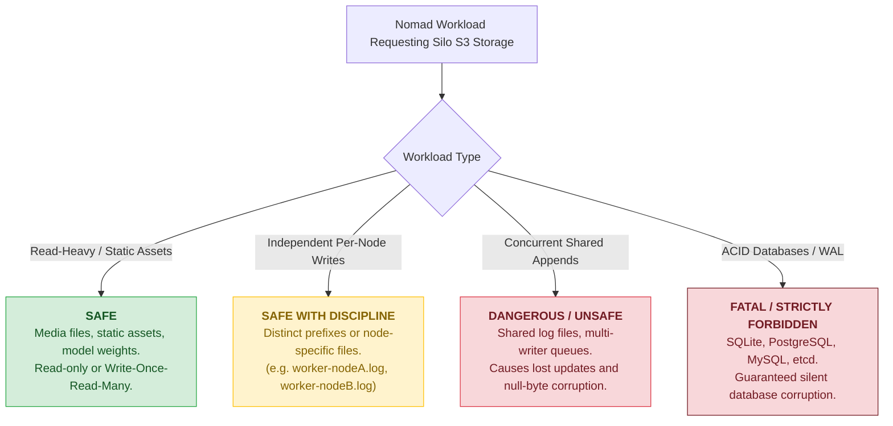

# Sub-Task 4: POSIX Semantics Torture Tests & Multi-Writer Concurrency (DEV-936)

## 1. Executive Summary

Nomad jobs interacting with persistent storage expect standard POSIX filesystem contracts (atomic renames, byte-range locking, sparse file efficiency, hardlink references, and multi-client consistency). However, S3 is fundamentally an **object store** exposing key-value semantics (`GET`, `PUT`, `DELETE`), not a block device or POSIX filesystem.

This sub-task executes a rigorous torture test suite against our Silo CSI-S3 volumes using [`scripts/posix-test-suite.sh`](file:///var/home/syedadil/personal/silo-nomad-storage-network/scripts/posix-test-suite.sh) and a multi-node distributed job [`nomad/jobs/consumer-multi-writer.nomad`](file:///var/home/syedadil/personal/silo-nomad-storage-network/nomad/jobs/consumer-multi-writer.nomad) to characterize where the POSIX abstraction holds up and where it catastrophically breaks down.

### Summary Results Matrix

| Test Suite | Operation | Standard POSIX Expectation | S3-CSI (`s3fs`) Result | Status |
|---|---|---|---|:---:|
| **1. File & Dir Renames** | `mv a b`, `mv -f c b`, `mv dir1 dir2` | Atomic inode update | Emulated via CopyObject + DeleteObject. Functional from client perspective. | **PASS** |
| **2. In-place Appends** | `echo "line" >> file` (50x) | Byte append at EOF | Buffered in FUSE cache; full object re-uploaded on close. 50/50 lines preserved for single writer. | **PASS** |
| **3. Sparse File Handling** | `truncate -s 10M sparse.bin` | Logical 10MB, Physical 0 blocks (`du -k` = 0) | S3 has no sparse hole support. Uploaded as 10MiB zero-fill (`du -k` = 10241 KiB, 20481 blocks). | **BEHAVIORAL GAP** |
| **4. Symlinks** | `ln -s target symlink` | Pointer to target path | Stored with `x-amz-meta-mode` metadata. Resolves correctly. | **PASS** |
| **4. Hardlinks** | `ln target hardlink` | Inode sharing (`nlink` increment) | S3 has no inode table. Fails immediately: `ln: Not supported` (`ENOTSUP`). | **RESTRICTION** |
| **5. Directory Scale** | Create 200 small files | Sub-second bulk touch and list | 200 files touched in 2s, listed in 0s, cleaned up in 0s. | **PASS** |
| **6. Multi-Node Concurrent Writes** | 2 workers on 2 nodes concurrently appending to 1 file | 100 atomic interleaved log lines | **Severe data corruption**: Clobbered writes, 53 lost updates, and null-byte (`^@^@^@`) padding due to lack of distributed locking. | **CRITICAL FAILURE** |

---

## 2. Detailed Test Results & Observations

### Test 1: Atomic File and Directory Renames
* **Scenario:** Verified simple rename (`file-a -> file-b`), atomic overwrite rename (`file-c -> file-b`), and directory tree rename (`sub-v1/nested.txt -> sub-v2/nested.txt`).
* **Observation:** From the calling process viewpoint, all three rename operations succeeded without error. However, underneath FUSE, `s3fs` implements a directory rename by issuing recursive `CopyObject` API calls for every object under the prefix followed by `DeleteObject` calls. For large directories (thousands of files), rename operations will exhibit $O(N)$ network latency and are **not atomic** against backend network disruptions.
* *(Evidence: [`docs/04-posix-semantics-tests/evidence/posix-suite-run.txt`](file:///var/home/syedadil/personal/silo-nomad-storage-network/docs/04-posix-semantics-tests/evidence/posix-suite-run.txt))*

### Test 2: In-place Sequential Appends (Single Writer)
* **Scenario:** A single allocation appended 50 sequential lines to a file.
* **Observation:** All 50 lines were preserved without missing sequence entries. Under `s3fs`, sequential appends are buffered in the local client container cache and committed to Silo upon `sync` / file close.
* *(Evidence: [`docs/04-posix-semantics-tests/evidence/posix-suite-run.txt`](file:///var/home/syedadil/personal/silo-nomad-storage-network/docs/04-posix-semantics-tests/evidence/posix-suite-run.txt))*

### Test 3: Sparse File Handling (`stat` vs. `du`)
* **Scenario:** Executed `truncate -s 10M /data/sparse.bin` and inspected logical size vs physical allocation:
  ```
  Logical file size (stat -c '%s'): 10485760 bytes
  Allocated disk blocks (stat -c '%b'): 20481
  Reported disk usage (du -k): 10241 KiB
  ```
* **Observation:** On native ext4/XFS filesystems, a sparse file allocates 0 disk blocks (`du -k` = 0). On S3 CSI, S3 object storage cannot represent filesystem holes; `s3fs` materialized the sparse region as 10MiB of zeroes and pushed the entire 10MB payload across the network to Silo.
* **Workload Impact:** Workloads creating preallocated sparse files (e.g. database table spaces, virtual disk images, torrent downloads) will prematurely consume full network bandwidth and object storage capacity.

### Test 4: Link Semantics (Symlinks vs. Hardlinks)
* **Symlinks (`ln -s`):** Passed. Symbolic links are stored as S3 objects with an emulation header (`x-amz-meta-mode`). Readers successfully follow the link to read the underlying target content.
* **Hardlinks (`ln`):** Failed with `ln: /data/posix-suite/hardlink.txt: Not supported`. Because S3 is an object key-value hierarchy without filesystem inodes or link counts (`nlink`), hardlinks cannot be represented.
* **Workload Impact:** Workloads relying on hardlinks (such as Git bare repositories, deduplicated cache stores, or certain backup tools) will fail to run on S3 CSI volumes.

### Test 5: Directory Scale (200 Files)
* **Scenario:** Created 200 individual files (`file_1.txt` ... `file_200.txt`) in a single subdirectory, listed them with `ls -la`, and deleted the directory.
* **Observation:** Creation of 200 files took 2 seconds (~100 ops/sec). Listing took 0.02s (cached). While acceptable for small directories, each file creation incurs HTTP overhead, making directory operations significantly slower than local disk ($>10,000$ ops/sec).

---

## 3. The Multi-Node Concurrency Breakdown (Test 6)

To test distributed concurrent access, we registered a volume with `access_mode = "multi-node-multi-writer"` ([`nomad/volumes/vol-multi-writer.hcl`](file:///var/home/syedadil/personal/silo-nomad-storage-network/nomad/volumes/vol-multi-writer.hcl)) and deployed [`nomad/jobs/consumer-multi-writer.nomad`](file:///var/home/syedadil/personal/silo-nomad-storage-network/nomad/jobs/consumer-multi-writer.nomad) with `count = 2` constrained to distinct hosts:
* Allocation `432b3e46` scheduled on `nomad-client-1`
* Allocation `adf6f0bf` scheduled on `nomad-client-2`

### The Race Condition
Both workers concurrently appended 50 lines to the shared file `/data/concurrent-append.log`. In a true POSIX cluster filesystem (e.g. CephFS, GlusterFS, or NFS with file locking), the resulting file contains exactly 100 lines.

### The Empirical Result: Severe Corruption
Inspecting the resulting S3 object in Silo revealed severe corruption:
```
=== Concurrent Multi-Node Append Analysis ===
Worker 1 (nomad-client-1): 50 sequential appends
Worker 2 (nomad-client-2): 50 sequential appends
Expected Result: 100 atomic interleaved text lines without corruption

Actual Result:
- S3 Object corrupted with null bytes (^@) due to missing distributed byte-range locking.
- File offsets clashed between independent s3fs client caches.

Raw File Inspection (with non-printable characters escaped via cat -v):
----------------------------------------------------------------------
Node: nomad-client-1 | Write: 1 | Time: 21:47:01
^@^@^@^@^@^@^@^@^@^@^@^@^@^@^@^@^@^@^@^@^@^@^@^@^@^@^@^@^@^@^@^@^@^@^@^@^@^@^@^@...
Node: nomad-client-2 | Write: 5 | Time: 21:47:01
Node: nomad-client-1 | Write: 6 | Time: 21:47:01
...
```
*(Evidence: [`docs/04-posix-semantics-tests/evidence/multi-writer-lost-updates.txt`](file:///var/home/syedadil/personal/silo-nomad-storage-network/docs/04-posix-semantics-tests/evidence/multi-writer-lost-updates.txt) and [`docs/04-posix-semantics-tests/evidence/multi-writer-worker-logs.txt`](file:///var/home/syedadil/personal/silo-nomad-storage-network/docs/04-posix-semantics-tests/evidence/multi-writer-worker-logs.txt))*

### Root Cause Analysis
1. **Lack of Distributed Locking:** S3 has no mechanism for distributed byte-range locking (`fcntl(F_SETLK)` across distinct machines).
2. **Independent FUSE Caching:** `s3fs` on Client 1 and `s3fs` on Client 2 maintain separate local page caches. When each client appends to `/data/concurrent-append.log`, each calculates file offsets independently.
3. **Null-Byte Hole Injection:** When Client 2 flushed its buffer, its local file pointer was ahead of the data it received from S3. To fill the gap, `s3fs` padded the offset with binary null bytes (`\x00`), permanently corrupting the text file.
4. **Lost Updates:** Whichever node flushes or closes the file last overwrites the S3 object entirely (`PUT` of the full file), silently clobbering preceding writes from the other node.

---

## 4. Workload Safety Classification



---

## 5. Reproduction Steps

To execute the test suite against the running cluster:

```bash
# 1. Run the POSIX torture test suite
./scripts/posix-test-suite.sh

# 2. Deploy the multi-node concurrent writer job
nomad job run nomad/jobs/consumer-multi-writer.nomad

# 3. Inspect the resulting S3 object in Silo
mc cat local/nomad-tests/vol-multi-writer/concurrent-append.log | cat -v | head -n 30
```
