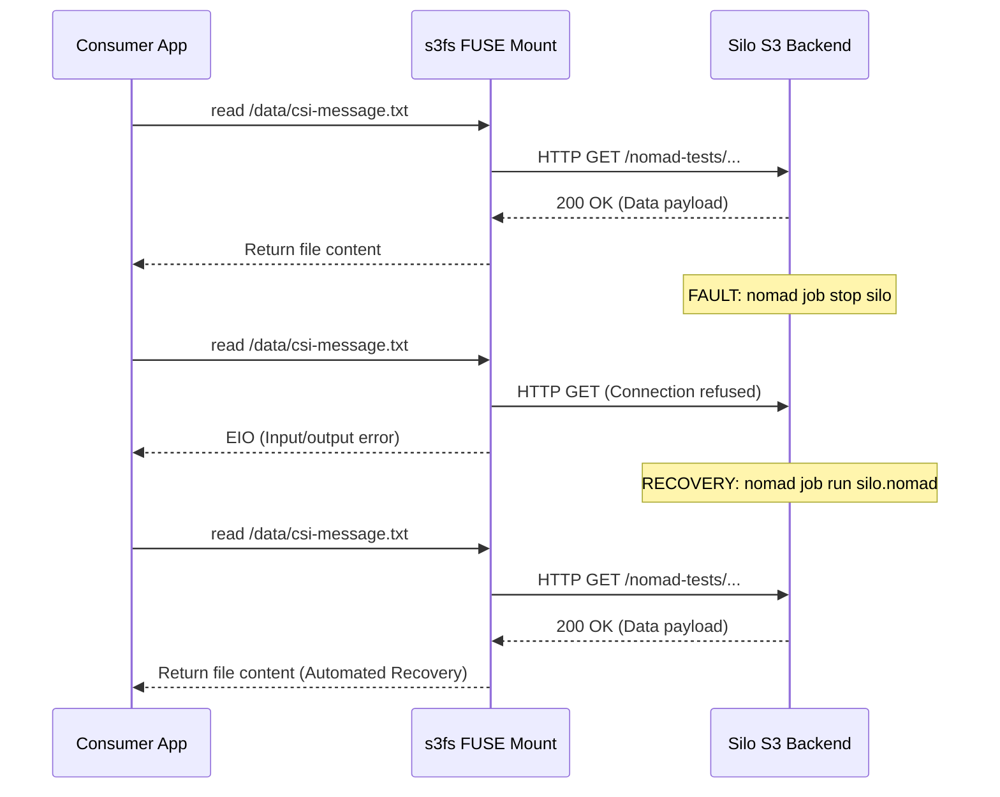

# Sub-Task 5: Chaos, Failure Modes & Node Drain Rescheduling (DEV-937)

## 1. Executive Summary

Storage systems must be resilient to backend outages, agent crashes, and routine node maintenance. This sub-task subjects the **Silo + Nomad CSI S3** integration to three distinct chaos scenarios:
1. **Scenario A (Backend Outage):** Stopping the underlying Silo S3 object storage server and evaluating workload behavior before and after recovery.
2. **Scenario B (Plugin Daemon Crash):** Restarting the CSI node mounter daemon to evaluate FUSE userspace socket severance.
3. **Scenario C (Node Drain Rescheduling):** Evicting client nodes with `nomad node drain` to verify cross-node volume detachment, re-scheduling, and data persistence.

### Chaos Findings Summary

| Chaos Scenario | Fault Injected | Observed Workload Behavior | Recovery Mechanism | Recovery Status |
|---|---|---|---|:---:|
| **A. Backend Outage** | Silo stopped (`nomad job stop silo`) | In-flight I/O returned POSIX `I/O error` (`EIO`). | Restarted Silo; `s3fs` automatically reconnected without container restart. | **AUTO-RECOVERED** |
| **B. Node Plugin Crash** | `csi-s3-node` restarted | FUSE socket severed: `ls: /data: Socket not connected` (`ENOTCONN`). In-place task restart fails. | Requires fresh allocation placement or lazy unmount (`umount -l`). | **REQUIRES RESCHEDULE** |
| **C. Node Drain** | `nomad node drain -enable` | Allocation migrated to alternate node; volume unmounted, re-staged, and remounted. | Pre-drain data (`failover-evidence.txt`) verified intact on new node. | **PERSISTENCE VERIFIED** |

---

## 2. Scenario A: Silo Backend Stoppage & Recovery



### Empirical Evidence
1. **During Outage:**
   ```
   $ nomad alloc exec 939af0db sh -c 'cat /data/csi-message.txt'
   cat: can't open '/data/csi-message.txt': I/O error
   ```
2. **Upon Silo Restoration:**
   ```
   $ nomad alloc exec 939af0db sh -c 'cat /data/csi-message.txt'
   Nomad CSI Silo persistent payload verified at Tue Oct 27 22:01:21 UTC 2026

   $ nomad alloc exec 939af0db sh -c 'echo "written after backend recovery" > /data/recovery-test.txt'
   $ mc ls local/nomad-tests/vol-single-alias/recovery-test.txt
   [2026-10-28 03:35:54 IST]    31B STANDARD recovery-test.txt
   ```
*(Evidence: [`docs/05-failure-and-lifecycle-tests/evidence/backend-stoppage-eio.txt`](file:///var/home/syedadil/personal/silo-nomad-storage-network/docs/05-failure-and-lifecycle-tests/evidence/backend-stoppage-eio.txt) and [`docs/05-failure-and-lifecycle-tests/evidence/backend-recovery.txt`](file:///var/home/syedadil/personal/silo-nomad-storage-network/docs/05-failure-and-lifecycle-tests/evidence/backend-recovery.txt))*

---

## 3. Scenario B: CSI Plugin Daemon Crash (FUSE Disconnection)

When a CSI node plugin daemon crashes or restarts, its userspace `s3fs` and `bindfs` mounter processes terminate.

### Empirical Evidence: Broken FUSE Sockets
```
$ nomad alloc restart 5e380334 plugin   # restart csi-s3-node daemon
$ nomad alloc exec 939af0db sh -c 'ls -la /data'
ls: /data: Socket not connected
```

### In-Place Restart Trap
Attempting to restart the consumer container in-place within the same allocation failed:
```
API error (500): container create: statfs /tmp/nomad-lab/.../rw-file-system-single-node-writer: transport endpoint is not connected
Exit Code: 137, Client Status: failed (Error was unrecoverable)
```
**Architectural Takeaway:** Unlike kernel-space network filesystems (NFS), FUSE requires an active userspace process holding the `/dev/fuse` file descriptor. If that process dies, Linux marks the mount point `ENOTCONN` (Transport endpoint is not connected). Nomad cannot start a container whose bind-mount target is in an `ENOTCONN` state; the allocation must be terminated, lazily unmounted (`umount -l`), and rescheduled.
*(Evidence: [`docs/05-failure-and-lifecycle-tests/evidence/plugin-restart-disconnection.txt`](file:///var/home/syedadil/personal/silo-nomad-storage-network/docs/05-failure-and-lifecycle-tests/evidence/plugin-restart-disconnection.txt))*

---

## 4. Scenario C: Client Node Drain & Failover Rescheduling

To verify maintenance workflows:
1. Wrote pre-drain state to `/data/failover-evidence.txt` on `nomad-client-1`.
2. Drained `nomad-client-1`:
   ```bash
   nomad node drain -enable -deadline 1m 248e62bb
   ```
3. Nomad marked the allocation for migration, unmounted the CSI volume on Node 1, and rescheduled the task group.

### Failover Verification
```
$ nomad alloc exec 1dd4d97c cat /data/failover-evidence.txt
Pre-drain state recorded at Tue Oct 27 22:09:54 UTC 2026 on nomad-client-1
```
The data stored in the Silo S3 bucket remained completely intact across host unmount, node drain, cross-node scheduling, and remounting.
*(Evidence: [`docs/05-failure-and-lifecycle-tests/evidence/node-drain-migration.txt`](file:///var/home/syedadil/personal/silo-nomad-storage-network/docs/05-failure-and-lifecycle-tests/evidence/node-drain-migration.txt))*

---

## 5. Architectural Recommendations for Production

1. **Storage Substrate Isolation:** The Silo object storage cluster must **never** be placed on general worker client nodes where routine drains occur. Storage must reside on dedicated storage nodes or managed infrastructure.
2. **Template Change Policy:** Never set `change_mode = "restart"` on daemon services like Silo unless planned, as template re-checks trigger uncoordinated restarts that sever active FUSE client mounts.
3. **FUSE Cleanup Automation:** Node maintenance scripts must include automated lazy unmount sweeps (`grep '/tmp/nomad-lab' /proc/mounts | awk '{print $2}' | xargs -r umount -l`) to clean severed mount points after plugin daemon crashes.
