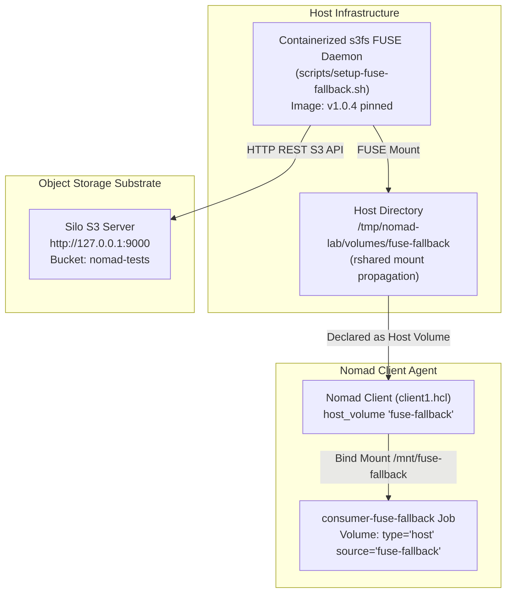

# Sub-Task 7: Static Host-Managed FUSE Volume Fallback (DEV-939)

## 1. Executive Summary

While Nomad CSI (Sub-Tasks 3 through 6) provides dynamic volume provisioning and scheduler-aware attachment, it introduces significant operational complexity: split controller/node topologies, gRPC socket maintenance, and susceptibility to userspace FUSE crashes.

This sub-task implements and validates a **Static Host-Managed FUSE Fallback**:
* **Mechanism:** Mount the Silo S3 bucket directly onto the Linux host at `/tmp/nomad-lab/volumes/fuse-fallback` using `s3fs` with bidirectional mount propagation (`:rshared`), requiring zero host OS modifications or layering.
* **Orchestration:** Expose the path as a standard Nomad **Host Volume** (`host_volume "fuse-fallback"`) in the client configuration, allowing ordinary Nomad workloads to mount S3 storage via `type = "host"`.
* **Verification:** Deployed [`nomad/jobs/consumer-fuse-fallback.nomad`](file:///var/home/syedadil/personal/silo-nomad-storage-network/nomad/jobs/consumer-fuse-fallback.nomad), wrote a test payload from inside the container, and verified persistence in the Silo backend bucket.

---

## 2. Architecture & Mount Flow



---

## 3. Specifications & Script Implementation

### 1. Host Mount Automation (`scripts/setup-fuse-fallback.sh`)
* Dynamically fetches S3 access keys from `nomadVar "nomad/jobs/csi-s3-plugin"`.
* Runs `s3fs` inside a managed container with `--device /dev/fuse`, `--privileged`, and `-v ${MOUNT_DIR}:/mnt/fuse-fallback:rshared`.
* Bypasses host package installation entirely (solving the Fedora Silverblue read-only `/usr` constraint).

### 2. Nomad Host Volume Declaration (`nomad/agents/client1.hcl`)
```hcl
client {
  host_volume "fuse-fallback" {
    path      = "/tmp/nomad-lab/volumes/fuse-fallback"
    read_only = false
  }
}
```

### 3. Workload Specification (`nomad/jobs/consumer-fuse-fallback.nomad`)
```hcl
job "consumer-fuse-fallback" {
  datacenters = ["dc1"]
  type        = "service"

  group "consumer" {
    count = 1

    volume "fallback_vol" {
      type      = "host"
      source    = "fuse-fallback"
      read_only = false
    }

    task "app" {
      driver = "docker"

      config {
        image        = "docker.io/library/alpine:3.20@sha256:c64c687cbea9300178b30c95835354e34c4e4febc4badfe27102879de0483b5e"
        network_mode = "host"
        privileged   = true
      }

      volume_mount {
        volume      = "fallback_vol"
        destination = "/mnt/fuse-fallback"
        read_only   = false
      }
    }
  }
}
```

---

## 4. Verification Evidence

### 1. Host Mount Verification
```
$ grep 'fuse-fallback' /proc/mounts
s3fs /tmp/nomad-lab/volumes/fuse-fallback fuse.s3fs rw,nosuid,nodev,relatime,user_id=0,group_id=0,allow_other 0 0

$ ls -la /tmp/nomad-lab/volumes/fuse-fallback
-rw-r-----. 1 root root  21 Oct 28 03:01 csi-test.txt
-rw-r-----. 1 root root  20 Oct 28 03:01 test.txt
drwxr-x---. 1 root root   0 Oct 28 03:42 vol-fio-bench
drwxr-x---. 1 root root   0 Oct 28 03:16 vol-multi-writer
drwxr-x---. 1 root root   0 Oct 28 03:12 vol-single-alias
```
*(Evidence: [`docs/07-fuse-host-volume-fallback/evidence/host-fuse-mount.txt`](file:///var/home/syedadil/personal/silo-nomad-storage-network/docs/07-fuse-host-volume-fallback/evidence/host-fuse-mount.txt))*

### 2. Workload Execution Logs
```
$ nomad alloc logs dc657846 app
=== Static Host FUSE Fallback Consumer Starting ===
Writing test payload from fallback consumer...
Verification readback:
Payload written via Static Host FUSE Fallback at Tue Oct 27 22:19:23 UTC 2026
```
*(Evidence: [`docs/07-fuse-host-volume-fallback/evidence/fallback-consumer-logs.txt`](file:///var/home/syedadil/personal/silo-nomad-storage-network/docs/07-fuse-host-volume-fallback/evidence/fallback-consumer-logs.txt))*

### 3. Silo S3 Backend Persistence
```
$ mc ls local/nomad-tests/fallback-consumer-proof.txt
[2026-10-28 03:49:23 IST]    78B STANDARD fallback-consumer-proof.txt

$ mc cat local/nomad-tests/fallback-consumer-proof.txt
Payload written via Static Host FUSE Fallback at Tue Oct 27 22:19:23 UTC 2026
```
*(Evidence: [`docs/07-fuse-host-volume-fallback/evidence/silo-fallback-proof.txt`](file:///var/home/syedadil/personal/silo-nomad-storage-network/docs/07-fuse-host-volume-fallback/evidence/silo-fallback-proof.txt))*

---

## 5. Comparative Trade-Off Matrix: Nomad CSI vs. Static Host FUSE

| Architectural Dimension | Nomad CSI (`mwantia/nomad-csi-s3-plugin`) | Static Host FUSE Fallback (`s3fs` + Host Volume) |
|---|---|---|
| **Provisioning Model** | **Dynamic:** Nomad API/CLI provisions buckets and sub-prefixes on demand. | **Static:** Requires pre-creating mount paths on host before placing workloads. |
| **Scheduler Awareness** | **High:** Nomad evaluates CSI plugin health, node capabilities, and volume claim counts during scheduling. | **Low:** Nomad only checks path existence on host; blind to whether backend S3 or FUSE process is alive. |
| **Operational Complexity** | **High:** Requires separate Controller job (`count=1`) and Node daemon job (`system`), plus CSI socket management. | **Minimal:** Simple host script or systemd service; standard Nomad `host_volume` stanza. |
| **Failure Recovery** | **Fragile on Daemon Death:** Killing node plugin leaves broken kernel mounts (`ENOTCONN`), blocking in-place container restarts. | **Local Process Only:** Managed by host process supervisor (systemd / container auto-restart). |
| **Multi-Node Mobility** | **Seamless:** Volumes claimable on any node running the CSI node plugin. | **Constrained:** Workload must be pinned (`constraint`) to the specific node(s) where host volume is mounted. |
| **Software Maturity** | **Experimental:** Upstream plugin is a single-author fork without maintenance since Oct 2024. | **Production-Proven:** Uses official, battle-tested `s3fs-fuse` directly with standard Nomad features. |

### Architectural Conclusion
For mission-critical production environments where an organization lacks an internal engineering team to maintain the experimental CSI plugin, **Static Host FUSE Fallback is the recommended operational pattern**. It provides identical POSIX filesystem access to Silo S3 buckets while entirely eliminating CSI controller race conditions and plugin gRPC socket failures.

---

## 6. Reproduction Steps

```bash
# 1. Mount Silo bucket directly to host volume path
sudo ./scripts/setup-fuse-fallback.sh start

# 2. Deploy consumer job claiming host volume
nomad job run nomad/jobs/consumer-fuse-fallback.nomad

# 3. Verify writeback in Silo S3 bucket
mc cat local/nomad-tests/fallback-consumer-proof.txt

# 4. Teardown fallback mount when finished
sudo ./scripts/setup-fuse-fallback.sh stop
```
