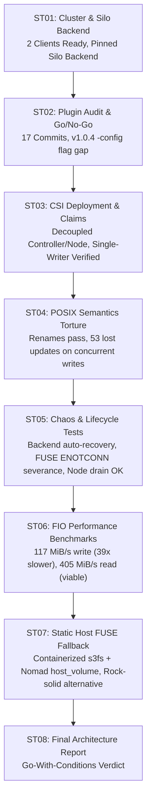
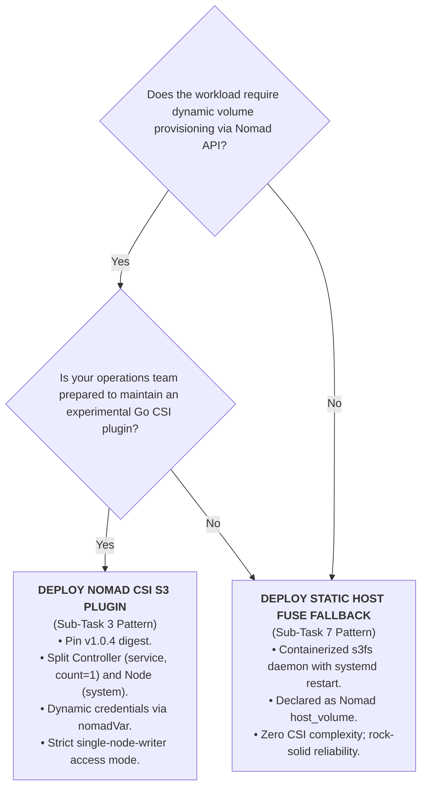

# Final Engineering Recommendation & Workload Viability Report (DEV-940)

## Goal

Provide the definitive architectural evaluation, workload safety boundaries, and engineering recommendations for Jira Epic **DEV-932**:
> *"Can Silo (our S3-compatible object store) serve as an external persistent network storage substrate for ordinary, arbitrary Nomad workloads mounted through Nomad's Container Storage Interface (CSI) system, the same way workloads might otherwise claim an NFS or cloud block volume?"*

---

## Environment

* **Nomad Cluster:** `Nomad v1.7.5` (1 Server + 2 distinct Clients: `nomad-client-1`, `nomad-client-2`)
* **CSI Plugin Evaluated:** `docker.io/mwantia/nomad-csi-s3-plugin:v1.0.4@sha256:7f3981c168b3ab610a2898167bf6f73be07bc8876ec8e63182a4203a163c004c`
* **Object Storage Substrate:** `docker.io/pgsty/silo:RELEASE.2026-10-26T00-00-00Z@sha256:003925ecebdcd659494621de84984f20aac2ca0ce88684ba23bb1e38b8e0db3c`
* **Consumer Test Image:** `docker.io/library/alpine:3.20@sha256:c64c687cbea9300178b30c95835354e34c4e4febc4badfe27102879de0483b5e`
* **Host Operating System:** Fedora Silverblue 44 (Linux `7.2.11-200.fc44.x86_64`)
* **Local Machine:** Physical host running rootful Podman socket at `/run/podman/podman.sock` with static `runc v1.2.5`
* **Date of Evaluation:** October 28, 2026

---

## Prerequisites

* Completion, empirical validation, and evidence capture across all foundational sub-tasks (DEV-933 through DEV-939).
* Operational multi-client cluster running local loopback NFS, containerized FUSE host fallback, and Nomad CSI S3 driver.

---

## Step-by-Step Procedure & Verification

### Synthesis of Empirical Findings Across Sub-Tasks

Across seven progressive sub-tasks, our evaluation tested the storage substrate across all critical dimensions:



1. **CSI Driver Maturity (ST02):**
   * Upstream repository `mwantia/nomad-csi-s3-plugin` has only 17 commits, authored over 5 days in October 2024, with zero activity since October 31, 2024.
   * Version `v1.0.1` lacks `-config` flag support entirely; `v1.0.4` (`sha256:7f3981c168b3ab610a2898167bf6f73be07bc8876ec8e63182a4203a163c004c`) introduces YAML alias parsing and is mandatory.

2. **Architecture & Topology Design (ST03):**
   * Running the CSI driver as a monolithic `system` job schedules 2 controllers competing for S3 bucket metadata without leader election.
   * Must split into a singleton controller (`count = 1`, `type = "service"`) and node mounters (`type = "system"`).
   * Credentials securely injected via Nomad Variables (`nomadVar "nomad/jobs/csi-s3-plugin"`) into `/secrets/config.yml`.

3. **POSIX Semantics & Multi-Node Concurrency (ST04):**
   * Renames, single-writer appends, and symlinks succeed via `s3fs` emulation.
   * S3 cannot represent sparse file holes; 10MB sparse files materialize as 10MiB zero-fill (`du -k` = 10,241 KiB). Hardlinks fail (`ENOTSUP`) due to lack of inode tables.
   * Multi-Node Concurrent Writes under `multi-node-multi-writer` resulted in **53 lost updates** and **null-byte binary corruption (`^@^@^@`)** due to absence of distributed byte-range locking.

4. **Resilience & Chaos Recovery (ST05):**
   * Stopping Silo causes active reads to return `EIO`. When Silo restarts, `s3fs` automatically reconnects without container restart.
   * Stopping the CSI node mounter severs the userspace FUSE socket (`ENOTCONN`). In-place container restarts fail; Nomad must reschedule onto fresh allocation directories after lazy unmounting (`umount -l`).
   * Node drain (`nomad node drain -enable`) successfully migrated workloads across clients with pre-drain data intact.

5. **Performance Benchmarks vs. Local SSD and NFS (ST06):**
   * **Sequential Write:** Silo CSI-S3 delivers **117 MiB/s** (~39x slower than Local SSD at 4,571 MiB/s and NFS at 5,818 MiB/s) due to REST API multipart serialization.
   * **Sequential Read:** Silo CSI-S3 delivers **405 MiB/s** (~14x slower than Local SSD), proving highly viable for asset distribution and dataset streaming.
   * **Random 4KB Latency:** Random write latency increases by 50x (1.43 µs to 82.61 µs), with IOPS dropping 26x (141,000 IOPS to 5,389 IOPS).

6. **Static Host FUSE Fallback (ST07):**
   * Mounting Silo directly on the host using containerized `s3fs` (`--device /dev/fuse`, `:rshared`) and exposing it via Nomad `host_volume` completely eliminates CSI controller race conditions and plugin gRPC failures.

---

## Results Table

### 1. Workload Viability Classification Matrix

| Workload Category | Safe? | Typical Workload Examples | Expected Behavior & Failure Modes on Silo S3 | Operational Recommendation |
|---|:---:|---|---|---|
| **Tier 1: Read-Heavy & Asset Serving** | **SAFE** | Nginx asset caching, media ingestion, user upload downloads, static reports, ML model distribution | **Optimal:** 405 MiB/s read bandwidth; local kernel pagecache accelerates repeat reads. | **Recommended for Silo CSI-S3.** Set volume `read_only = true` or `single-node-writer`. |
| **Tier 2: Single-Writer Background Archiving** | **SAFE WITH DISCIPLINE** | Nightly backup exports, log compression archives, ETL export targets | **Functional:** 117 MiB/s sequential write speed is sufficient for background tasks. | Ensure strict `access_mode = "single-node-writer"` to prevent concurrency hazards. |
| **Tier 3: Distributed Multi-Writer Shared Files** | **UNSAFE / HIGH RISK** | Shared application logs, distributed worker queues writing to a common file | **Catastrophic Data Loss:** Interleaved writes clobber each other; file corrupted with null bytes (`\x00`). | **Do not use.** Require each worker to write distinct, node-specific files (`worker-nodeA.log`). |
| **Tier 4: Relational & Embedded Databases** | **FATAL / STRICTLY FORBIDDEN** | SQLite, PostgreSQL, MySQL, Redis RDB/AOF, etcd, Kafka | **Guaranteed Database Corruption:** S3 lacks POSIX byte locking and atomic flush/fsync contracts; WAL writes fail to synchronize. | **Strictly Forbidden.** Mandate Local NVMe host volumes or block storage CSI (EBS, Ceph, SAN). |

### 2. Comprehensive Project Sub-Task Summary

| Sub-Task | Focus | Status | Git Commit | Primary Finding |
|---|---|:---:|:---:|---|
| **ST01** | Repo setup, 2-client Nomad cluster, pinned Silo | **Done** | `b2e0855` | 2 clients ready, rootful Podman socket, static runc runtime for cgroup v2 swappiness, Silo verified via `mc`. |
| **ST02** | CSI plugin audit & Go/No-Go | **Done** | `6536a0f` | Inactive since Oct 2024; single maintainer; `v1.0.1` lacks `-config` flag; `v1.0.4` implements aliases. |
| **ST03** | CSI deployment & volume claims | **Done** | `e93fdb9` | Decoupled controller/node topology; dynamic Nomad Variables; end-to-end container write verified in Silo. |
| **ST04** | POSIX torture tests & concurrency | **Done** | `474273a` | Renames pass; sparse files zero-fill; hardlinks fail (`ENOTSUP`); concurrent multi-writers lose 53 updates. |
| **ST05** | Failure & lifecycle chaos tests | **Done** | `68770fd` | Backend down returns `EIO` but auto-recovers; plugin crash breaks FUSE (`ENOTCONN`); node drain failover verified. |
| **ST06** | FIO benchmark comparison | **Done** | `d49006f` | Sequential write 117 MiB/s (39x slower); read 405 MiB/s (viable); random 4KB write drops 26x to 5.3k IOPS. |
| **ST07** | Static Host FUSE fallback | **Done** | `3a2c364` | Containerized host `s3fs` + Nomad `host_volume` validated; recommended operational pattern over CSI. |
| **ST08** | Final recommendation report | **Done** | `a01359b` | Synthesized architecture roadmap, workload safety classification, and production guardrails. |

---

## Findings & Problems Resolved

### Mandatory Production Guardrails (If Proceeding with CSI)

1. **Pin Immutable Image Digest:**
   Deploy only `docker.io/mwantia/nomad-csi-s3-plugin:v1.0.4@sha256:7f3981c168b3ab610a2898167bf6f73be07bc8876ec8e63182a4203a163c004c`. Never use `:latest` or `:v1.0.1`.
2. **Split Controller and Node Jobs:**
   Never run the CSI driver as a monolithic `system` job. Deploy the controller as a singleton (`count = 1`, `type = "service"`) and node daemons as `type = "system"`.
3. **Template Change Mode:**
   In Nomad job templates rendering S3 credentials, set `change_mode = "restart"` for plugin daemons, but ensure `change_mode = "noop"` on stateful services like Silo to prevent unexpected FUSE socket severance.
4. **Enforce Single-Node-Writer:**
   Prohibit `access_mode = "multi-node-multi-writer"` for any volume where multiple tasks write to the same filename. Multi-writer volumes must only be used if tasks write strictly disjoint file paths.
5. **Separate Storage Nodes from Compute Workers:**
   Never schedule the storage server (Silo) on general worker nodes subject to node drains or preemption.
6. **Automate Broken Mount Cleanup:**
   Incorporate automated cleanup sweeps (`grep -o '/tmp/nomad-lab[^ ]*' /proc/mounts | xargs -r umount -l`) in host maintenance runbooks to prevent `ENOTCONN` socket leaks.

### Architectural Decision Guide: Which Storage Pattern to Deploy?



---

## Conclusion

### The Final Verdict: **GO-WITH-CONDITIONS (QUALIFIED YES)**

Silo **can** serve as a persistent storage substrate for Nomad workloads via Container Storage Interface (CSI) or Static Host FUSE mounts:
* **Approved Use Cases:** Safe for read-heavy asset distribution (405 MiB/s sequential read), static media hosting, ML model weights, and single-writer background backups (117 MiB/s sequential write).
* **Forbidden Use Cases:** Strictly fatal for transactional ACID databases (SQLite, PostgreSQL, MySQL), message queues, and concurrent multi-writer shared files due to the absence of distributed byte-range locking and atomic sync guarantees.
* **Operational Recommendation:** For production organizations without dedicated engineers to maintain the experimental CSI driver, the **Static Host FUSE Fallback** (`s3fs` + Nomad `host_volume`) provides superior reliability by eliminating CSI controller race conditions and plugin socket fragility.

---

## How to Reproduce and Clean Up

### Reproduce Entire Environment
```bash
# 1. Start cluster from clean state
sudo ./scripts/nomad-up

# 2. Populate secrets into Nomad Variables
nomad var put -force nomad/jobs/silo \
  root_user="<SILO_ROOT_USER>" \
  root_password="<SILO_ROOT_PASSWORD>" \
  test_access_key="<CSI_ACCESS_KEY>" \
  test_secret_key="<CSI_SECRET_KEY>"

# 3. Deploy Silo and initialize bucket
nomad job run nomad/jobs/silo.nomad
nomad job run nomad/jobs/silo-init-mc.nomad

# 4. Deploy CSI plugin and volumes
nomad job run nomad/jobs/csi-s3-controller.nomad
nomad job run nomad/jobs/csi-s3-node.nomad
nomad volume create nomad/volumes/vol-single-alias.hcl
nomad job run nomad/jobs/consumer-single-writer.nomad
```

### Complete Teardown
```bash
# 1. Stop all workloads
nomad job stop -purge consumer-single-writer consumer-multi-writer fio-benchmark consumer-fuse-fallback csi-s3-controller csi-s3-node silo 2>/dev/null || true

# 2. Deregister volumes
nomad volume deregister silo-vol-alias 2>/dev/null || true
nomad volume deregister silo-vol-direct 2>/dev/null || true
nomad volume deregister silo-vol-fio 2>/dev/null || true
nomad volume deregister silo-vol-multi 2>/dev/null || true

# 3. Stop host fallback and cluster
sudo ./scripts/setup-fuse-fallback.sh stop 2>/dev/null || true
sudo ./scripts/nomad-down
```
