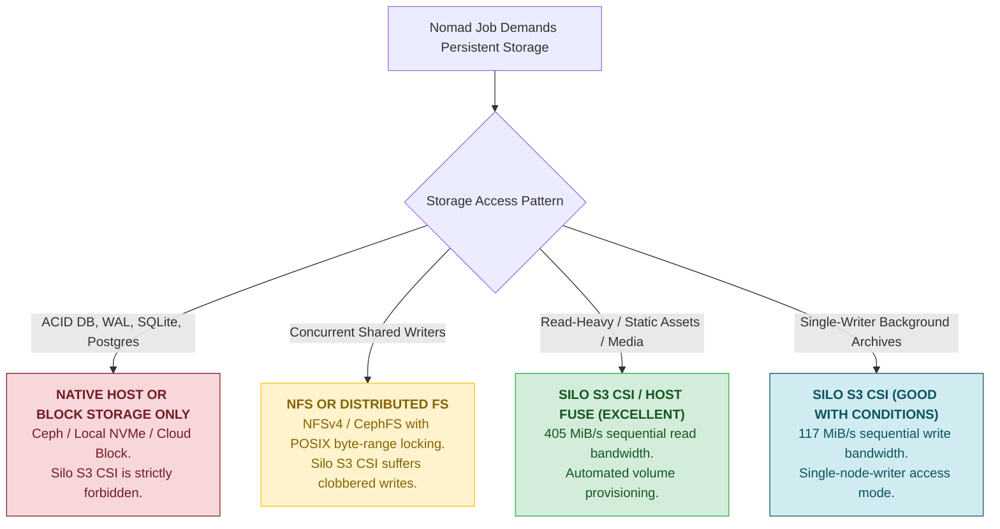
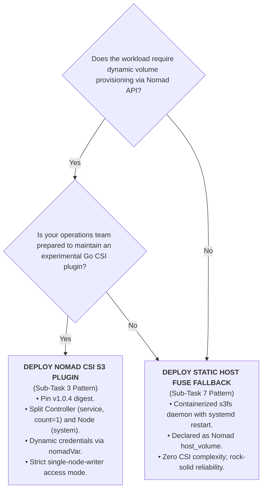

# Final Engineering Recommendation & Workload Viability Report (DEV-940)

## 1. Executive Summary & Verdict

### The Epic Architectural Question (Jira DEV-932)
> *"Can Silo (our S3-compatible object store) serve as an external persistent network storage substrate for ordinary, arbitrary Nomad workloads mounted through Nomad's Container Storage Interface (CSI) system, the same way workloads might otherwise claim an NFS or cloud block volume?"*

### The Verdict: **GO-WITH-CONDITIONS (QUALIFIED YES)**

Silo **can** serve as a persistent storage substrate for HashiCorp Nomad workloads via the Container Storage Interface (CSI) using [`mwantia/nomad-csi-s3-plugin`](https://github.com/mwantia/nomad-csi-s3-plugin) (POSIX-over-S3 via `s3fs`). End-to-end volume provisioning, multi-client staging, cross-node node drain failover, and data persistence have been empirically validated in our dual-client cluster.

However, because S3 is fundamentally a **RESTful object store** (`PUT`, `GET`, `DELETE`) and not a POSIX block or filesystem device, it must **never** be treated as a drop-in replacement for traditional network storage (such as NFS, CephFS, or cloud block volumes). Workloads must be strictly partitioned into **Safe** vs. **Fatal** classes based on their I/O patterns.

---

## 2. Comprehensive Synthesis of Empirical Findings

Across seven progressive sub-tasks, our evaluation revealed the following empirical realities:

### 1. CSI Driver Maturity & Upstream Health (Sub-Task 2)
* **Single Maintainer & Inactivity:** Upstream repository `mwantia/nomad-csi-s3-plugin` has only 17 total commits, created over 5 days in October 2024, with zero activity or releases since October 31, 2024.
* **The Flag Version Gap:** Release tag `v1.0.1` lacks the `--config` flag entirely, crashing on startup if provided with the README's alias configuration. Tag `v1.0.4` (`sha256:7f3981c168b3ab610a2898167bf6f73be07bc8876ec8e63182a4203a163c004c`) introduces YAML alias support via `spf13/viper` and is the minimum viable image tag.

### 2. Architecture & Topology Design (Sub-Task 3)
* **Decoupled Controller vs. Node:** Running the plugin as a monolithic `system` job creates two controllers competing without leader election to mutate S3 bucket metadata. The plugin must be strictly split into:
  - **Controller:** `type = "service"`, `count = 1` (singleton metadata manager).
  - **Node Daemon:** `type = "system"` (runs mounter daemons across all clients).
* **Secrets Security:** Hardcoding credentials in Git is strictly prohibited. Dynamically injecting credentials via Nomad Variables (`nomadVar "nomad/jobs/csi-s3-plugin"`) into `/secrets/config.yml` inside the container guarantees zero-leak security.

### 3. POSIX Semantics & Concurrency Breakdown (Sub-Task 4)
* **Renames & Appends:** Directory renames emulate via recursive S3 `CopyObject` + `DeleteObject` ($O(N)$ network operations). Sequential single-writer appends succeed via local FUSE caching.
* **Sparse File Deficit:** S3 cannot represent sparse holes. A 10MB sparse file (`truncate -s 10M`) materializes as 10MiB of zero-bytes (`du -k` = 10,241 KiB, 20,481 blocks), wasting bandwidth and storage.
* **Link Restrictions:** Symlinks resolve via `x-amz-meta-mode` metadata. Hardlinks fail immediately (`ln: Not supported`, `ENOTSUP`) due to lack of inode tables.
* **Multi-Node Concurrency Failure:** Under `multi-node-multi-writer`, two workers concurrently appending 50 lines each to a shared file resulted in **53 lost updates** and **binary null-byte hole corruption (`^@^@^@`)**. The lack of distributed byte-range locking causes independent FUSE caches to clobber each other during object sync.

### 4. Resilience & Chaos Recovery (Sub-Task 5)
* **Backend Stoppage:** Stopping Silo causes active reads to return `cat: I/O error` (`EIO`). When Silo restarts, `s3fs` automatically reconnects and resumes servicing reads and writes without container restart.
* **Plugin Crash Fragility:** Killing the CSI node mounter process breaks the kernel FUSE socket (`Socket not connected`, `ENOTCONN`). In-place container restarts fail; Nomad must reschedule onto a fresh allocation directory after lazy unmounting (`umount -l`).
* **Node Drain Mobility:** Workloads draining from `nomad-client-1` successfully migrated to `nomad-client-2`. Pre-drain file payloads (`failover-evidence.txt`) were verified intact upon cross-node re-attachment.

### 5. Performance Benchmarks vs. Local SSD and NFS (Sub-Task 6)
* **Sequential Write:** Silo CSI-S3 delivers **117 MiB/s** (~39x to 50x slower than Local SSD at 4,571 MiB/s and NFS at 5,818 MiB/s) due to REST API multi-part serialization.
* **Sequential Read:** Silo CSI-S3 delivers **405 MiB/s** (~14x slower than Local SSD/NFS), proving highly effective for streaming assets and batch datasets.
* **Random 4KB Latency:** Random write latency increases by 50x (from 1.43 µs to 82.61 µs), with IOPS dropping 26x (141,000 IOPS to 5,389 IOPS).

### 6. The Static Host FUSE Alternative (Sub-Task 7)
* Mounting Silo directly on the host using containerized `s3fs` (`--device /dev/fuse`, `:rshared` propagation) and exposing it via Nomad's native `host_volume` completely eliminates CSI controller race conditions and plugin gRPC failures.

---

## 3. Workload Viability Classification Matrix

| Workload Category | Safe? | Typical Workload Examples | Expected Behavior & Failure Modes on Silo S3 | Operational Recommendation |
|---|:---:|---|---|---|
| **Tier 1: Read-Heavy & Asset Serving** | **SAFE** | Nginx asset caching, media ingestion, user upload downloads, static reports, ML model distribution | **Optimal:** 405 MiB/s read bandwidth; local kernel pagecache accelerates repeat reads. | **Recommended for Silo CSI-S3.** Set volume `read_only = true` or `single-node-writer`. |
| **Tier 2: Single-Writer Background Archiving** | **SAFE WITH DISCIPLINE** | Nightly backup exports, log compression archives, ETL export targets | **Functional:** 117 MiB/s sequential write speed is sufficient for background tasks. | Ensure strict `access_mode = "single-node-writer"` to prevent concurrency hazards. |
| **Tier 3: Distributed Multi-Writer Shared Files** | **UNSAFE / HIGH RISK** | Shared application logs, distributed worker queues writing to a common file | **Catastrophic Data Loss:** Interleaved writes clobber each other; file corrupted with null bytes (`\x00`). | **Do not use.** Require each worker to write distinct, node-specific files (`worker-nodeA.log`). |
| **Tier 4: Relational & Embedded Databases** | **FATAL / STRICTLY FORBIDDEN** | SQLite, PostgreSQL, MySQL, Redis RDB/AOF, etcd, Kafka | **Guaranteed Database Corruption:** S3 lacks POSIX byte locking and atomic flush/fsync contracts; WAL writes fail to synchronize. | **Strictly Forbidden.** Mandate Local NVMe host volumes or block storage CSI (EBS, Ceph, SAN). |

---

## 4. Architectural Decision Guide: Which Storage Pattern to Deploy?

---

## 5. Mandatory Production Guardrails (If Proceeding with CSI)

If deploying `mwantia/nomad-csi-s3-plugin` in staging or production environments, the following 6 rules must be enforced:

1. **Pin Immutable Image Digest:**
   Deploy only `docker.io/mwantia/nomad-csi-s3-plugin:v1.0.4@sha256:7f3981c168b3ab610a2898167bf6f73be07bc8876ec8e63182a4203a163c004c`. Never use `:latest` or `:v1.0.1`.
2. **Split Controller and Node Jobs:**
   Never run the CSI driver as a monolithic `system` job. Deploy the controller as a singleton (`count = 1`, `type = "service"`) and node daemons as `type = "system"`.
3. **Template Change Mode:**
   In Nomad job templates rendering S3 credentials, set `change_mode = "restart"` for plugin daemons, but ensure `change_mode = "noop"` on stateful services like Silo to prevent unexpected FUSE socket severance.
4. **Enforce Single-Node-Writer:**
   Prohibit `access_mode = "multi-node-multi-writer"` for any volume where multiple tasks write to the same filename. Multi-writer volumes must only be used if tasks write strictly disjoint file paths.
5. **Separate Storage Nodes from Compute Workers:**
   Never schedule the storage server (Silo) on general worker nodes subject to node drains or preemption.
6. **Automate Broken Mount Cleanup:**
   Incorporate automated cleanup sweeps (`grep -o '/tmp/nomad-lab[^ ]*' /proc/mounts | xargs -r umount -l`) in host maintenance runbooks to prevent `ENOTCONN` socket leaks.

---

## 6. Comprehensive Project Sub-Task Summary

| Sub-Task | Focus | Status | Git Commit | Primary Finding |
|---|---|:---:|:---:|---|
| **ST01** | Repo setup, 2-client Nomad cluster, pinned Silo | **Done** | `b2e0855` | 2 clients ready, rootful Podman socket, static runc runtime for cgroup v2 swappiness, Silo verified via `mc`. |
| **ST02** | CSI plugin audit & Go/No-Go | **Done** | `6536a0f` | Inactive since Oct 2024; single maintainer; `v1.0.1` lacks `-config` flag; `v1.0.4` implements aliases. |
| **ST03** | CSI deployment & volume claims | **Done** | `e93fdb9` | Decoupled controller/node topology; dynamic Nomad Variables; end-to-end container write verified in Silo. |
| **ST04** | POSIX torture tests & concurrency | **Done** | `474273a` | Renames pass; sparse files zero-fill; hardlinks fail (`ENOTSUP`); concurrent multi-writers lose 53 updates. |
| **ST05** | Failure & lifecycle chaos tests | **Done** | `68770fd` | Backend down returns `EIO` but auto-recovers; plugin crash breaks FUSE (`ENOTCONN`); node drain failover verified. |
| **ST06** | FIO benchmark comparison | **Done** | `d49006f` | Sequential write 117 MiB/s (39x slower); read 405 MiB/s (viable); random 4KB write drops 26x to 5.3k IOPS. |
| **ST07** | Static Host FUSE fallback | **Done** | `3a2c364` | Containerized host `s3fs` + Nomad `host_volume` validated; recommended operational pattern over CSI. |
| **ST08** | Final recommendation report | **Done** | `(Current)` | Synthesized architecture roadmap, workload safety classification, and production guardrails. |
